<div align="center">

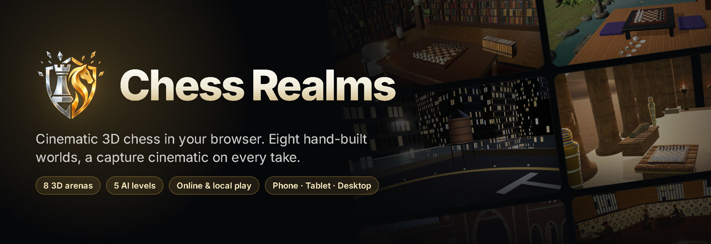

<br>

<a href="https://chess-realms.vercel.app"></a>

<br><br>


<br><br>

**Play the computer, a friend on the same device, or a friend online — across eight hand-built 3D worlds,<br>with a capture cinematic on every take.** No install, no sign-up: it runs in any modern browser.

</div>

<br>

<p align="center">
  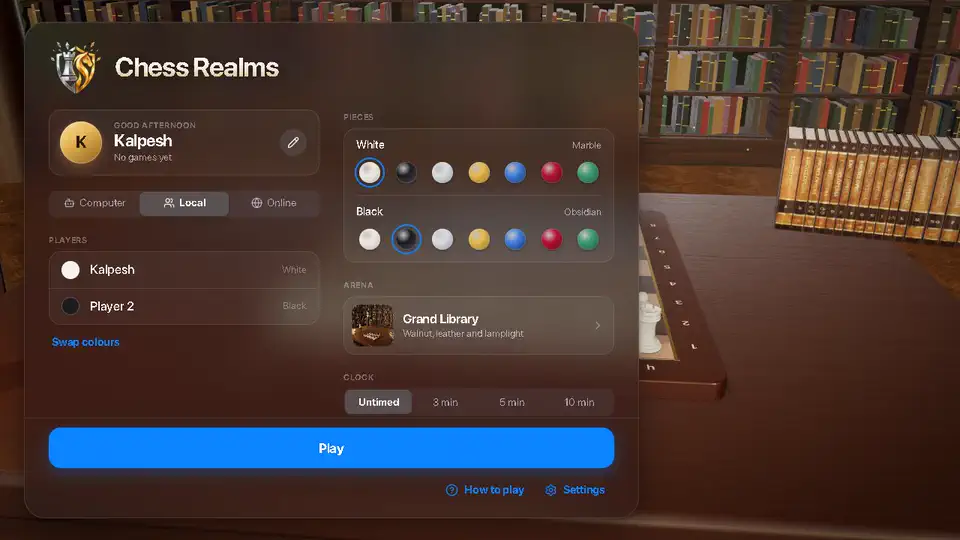
</p>

---

## 🏛️ Eight worlds

Every arena is modelled in real 3D around the board and lit by real HDR light, using CC0 scanned textures and models.

<table>
  <tr>
    <td width="25%">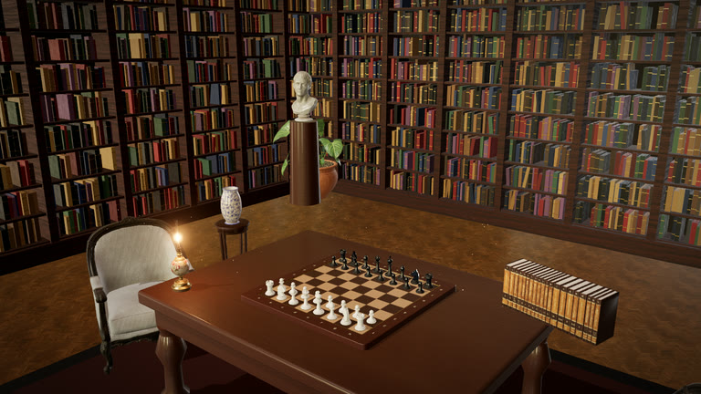<br><b>Grand Library</b><br><sub>Walnut bookcases, leather and lamplight</sub></td>
    <td width="25%">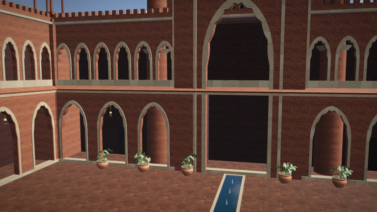<br><b>Palace Courtyard</b><br><sub>Rajput palace of sandstone and marble</sub></td>
    <td width="25%">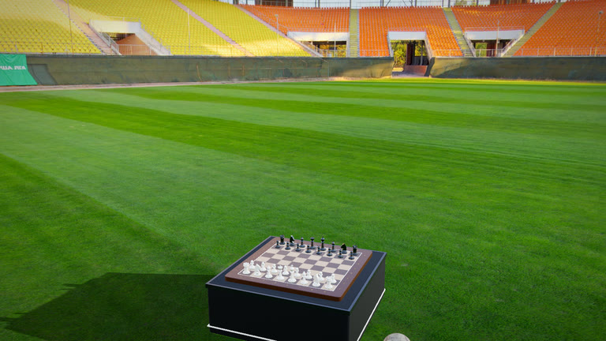<br><b>Football Stadium</b><br><sub>Centre circle at golden hour</sub></td>
    <td width="25%">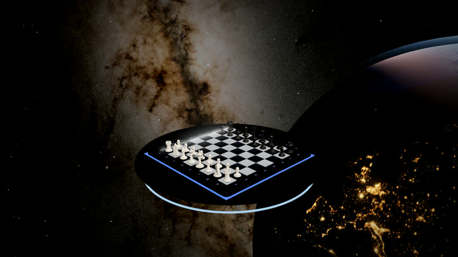<br><b>Deep Space</b><br><sub>In orbit above Earth (NASA imagery)</sub></td>
  </tr>
  <tr>
    <td width="25%">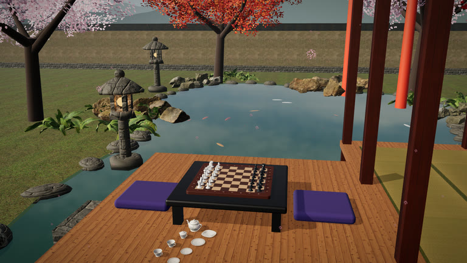<br><b>Kyoto Garden</b><br><sub>Tea house, koi pond and cherry blossom</sub></td>
    <td width="25%">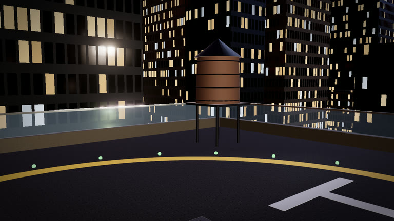<br><b>Metropolis Night</b><br><sub>Rooftop helipad above the city</sub></td>
    <td width="25%">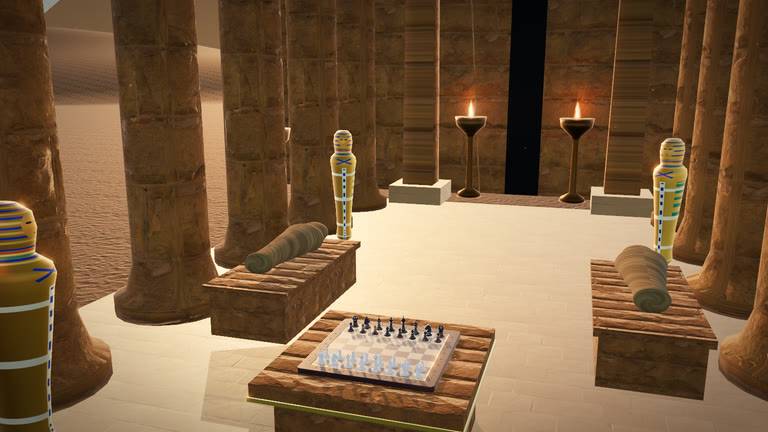<br><b>Pharaoh Sands</b><br><sub>Temple of the pyramids at sunset</sub></td>
    <td width="25%">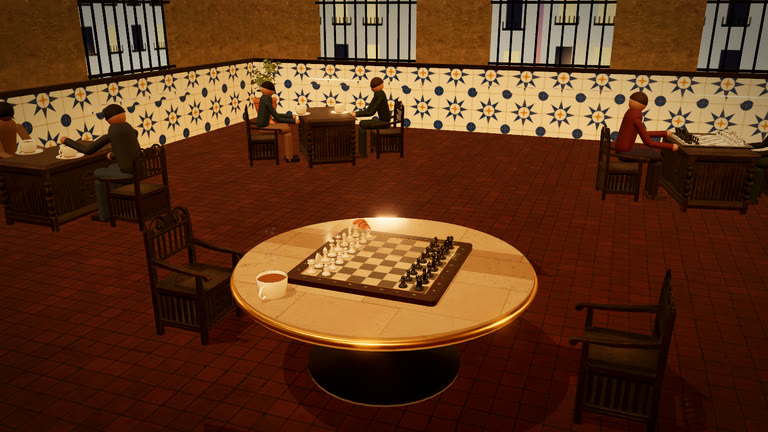<br><b>Spanish Café</b><br><sub>Café con leche and chess in Seville</sub></td>
  </tr>
</table>

## ✨ Features

| | |
|---|---|
| 🎬 **Capture cinematics** | Every capture plays a short, varied camera shot with slow motion, shatter and dust — skippable with a tap or <kbd>Space</kbd>. |
| 🤖 **Five AI levels** | Beginner (≈600) to Master (≈2400). The search runs in a Web Worker, so the board never freezes while it thinks. |
| 🌐 **Online rooms** | Create a room, share the code, play a friend over WebRTC. Each player picks their own piece set. |
| 👥 **Local two-player** | Pass-and-play on one device, with the camera turning to whoever's move it is. |
| 💎 **Seven piece finishes** | Marble, obsidian, silver, gold, sapphire, ruby and jade, physically based. |
| 📱 **Phone, tablet, desktop** | Responsive glass UI tested on 12 screen sizes; one-tap **2D / 3D** view on phones. |
| ⚡ **Built to stay smooth** | Lighter detail on phones, adaptive resolution, a 30 fps idle mode that stops phones heating up, and an Auto quality that steps down by itself on weak GPUs. |
| 🎵 **Procedural audio** | Every sound and each arena's ambience is synthesised in the browser — no audio files. |
| 🏆 **Highlights & records** | Best-moment replay after each game, win/loss record and head-to-head history on the device. |
| ⌨️ **Keyboard & gamepad** | Play the whole game without a mouse. |

## 📱 On your phone

<p align="center">
  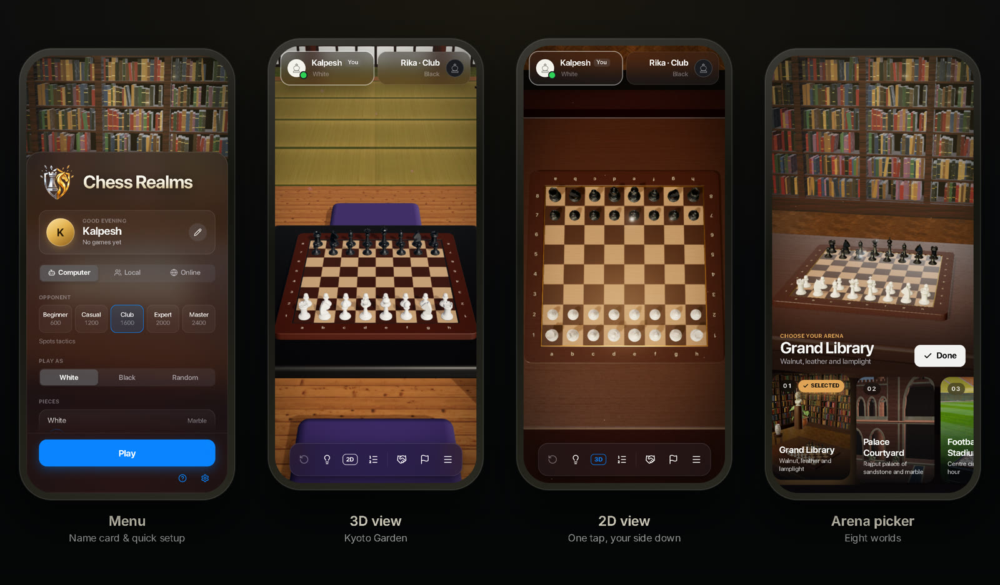
</p>

## 🧭 How it's built

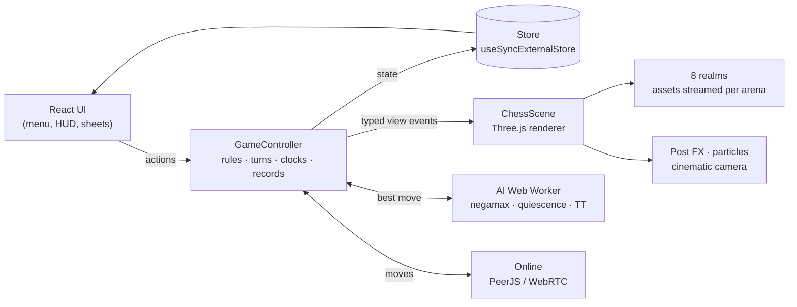

- **Rules engine** — perft-verified move generation; checks, castling, en passant, promotion and every draw rule.
- **Rendering** — raw Three.js r186: ACES tone mapping, bloom, PCF soft shadows that update only when something moves, instanced and merged scenery.
- **Assets** — each arena loads its own HDR, textures and meshopt-compressed models only when chosen.

## 🎮 Controls

| | |
|---|---|
| **Move** | Drag a piece, or tap it and tap a square. Dots = moves, rings = captures. |
| **Camera** | Drag empty space to orbit, scroll / pinch to zoom. Phones: **2D / 3D** button. Desktop: **Camera** button or <kbd>C</kbd>. |
| **Keyboard** | Arrows move a cursor, <kbd>Enter</kbd> selects, <kbd>Space</kbd> skips an animation, <kbd>U</kbd> undo, <kbd>H</kbd> hint, <kbd>D</kbd> draw, <kbd>R</kbd> resign, <kbd>M</kbd> mute, <kbd>Esc</kbd> pause. |
| **Gamepad** | D-pad moves the cursor, <kbd>A</kbd> select, <kbd>B</kbd> cancel, <kbd>X</kbd> hint, <kbd>Y</kbd> camera, <kbd>LB</kbd> undo, <kbd>Start</kbd> pause. |

## 🚀 Run it locally

```bash
git clone https://github.com/kalpeshmahajan21/chess-realms.git
cd chess-realms
npm install
npm run dev        # http://localhost:3000
```

```bash
npm test           # rules (perft), gameplay, AI, regression and score-tracker tests
npm run typecheck  # strict TypeScript
npm run build      # static site in dist/ (deploys anywhere: Vercel, Netlify, Cloudflare Pages)
```

No environment variables or server are needed. Every push to `main` deploys to [chess-realms.vercel.app](https://chess-realms.vercel.app).

<details>
<summary><b>Project layout</b></summary>

```
src/
  App.tsx                 Screen routing, overlays, global controls
  config/                 gameConfig (timings, AI levels), arenaThemes, quality tiers
  game/                   GameController, store, highlight scoring
  engine/                 Rules engine, AI search, Web Worker + client
  render/                 ChessScene, CameraRig, pieces, board, effects, post FX
  render/realms/          One file per arena + shared kit and asset loader
  audio/soundEngine.ts    Procedural SFX and ambience
  input/useControls.ts    Keyboard + gamepad
  ui/                     Design-system kit and every screen
public/realms/            HDRIs, textures, models and NASA maps, loaded per arena
docs/                     Credits, changelog, media
```

</details>

## 🙏 Credits

Textures, HDRIs and models from [Poly Haven](https://polyhaven.com) (CC0). Milky Way, Earth and Moon imagery from NASA (public domain).
Full list in [docs/CREDITS.md](docs/CREDITS.md) · changelog in [docs/CHANGES.md](docs/CHANGES.md).

<div align="center">
<br>
<a href="https://chess-realms.vercel.app"><b>▶ Play Chess Realms</b></a>
<br><br>
<sub>Made with ♟ by <a href="https://github.com/kalpeshmahajan21">Kalpesh Mahajan</a></sub>
</div>
